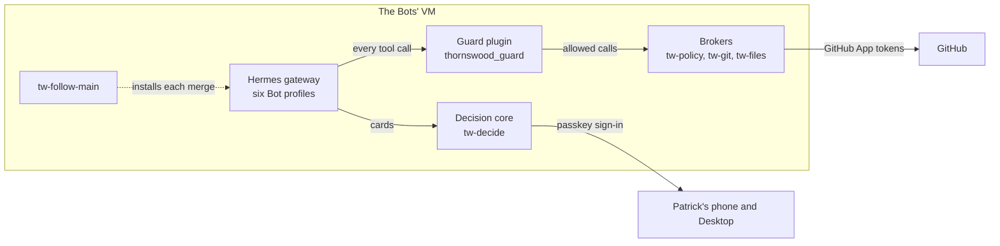

# TWHermesAgents

The six AI agents that help run [Thornswood](https://github.com/ThornswoodRP/Thornswood), a co-op roleplay server for Skyrim Special Edition built on SkyMP, and the guard rails that keep them safe.

The agents (the Bots) run on [Hermes Agent](https://github.com/NousResearch/hermes-agent) on one Linux VM. They triage the board, write fixes on their own branches, open pull requests and keep the release pipeline moving. This repository holds everything that decides what they may do and puts it on the VM: the policy, the guard plugin, the brokers that hold every credential, the decision app Patrick answers them from, and the install that keeps the VM on `main`.

No Bot can write to this repository: the guard and the git broker both refuse it. Every change here comes from the team as a pull request and merges only once its tests pass.

## The Bots

| Bot | Role | Works on |
|---|---|---|
| **Bramble** | Router | Hands out work, merges what is green, starts releases and deploys |
| **Rift** | Worker | The mod collection, load order and permissions |
| **Sprocket** | Worker | The launcher, the installer and the update feed |
| **Echo** | Worker | The website, the Discord bot, voice, and the lore and help text |
| **Magpie** | Worker | GitHub, CI, runners and security |
| **Wisp** | Worker | The gamemode, game systems and UI, and the engine fork |

## How it works



- **The policy** (`src/thornswood_guard/policy.yaml`) is every rule as data: the six Bots, the two GitHub Apps, what each Bot may push, merge and start, the model routes, the claim labels and the host's limits.
- **The guard** is a Hermes plugin in every Bot's profile. It checks each tool call before Hermes runs it and refuses anything the policy does not allow, with the reason. If it cannot read the policy, it refuses everything.
- **The brokers** run as their own Linux users. The Bots hold no GitHub credential at all: every GitHub write goes through `tw-git`, which checks it against the policy again and holds the Apps' keys where the Bots cannot read them.
- **The decision core** is where a Bot asks Patrick for a decision. He answers from an installable phone app or a Hermes Desktop pane, behind a passkey.
- **The follower** (`tw-follow-main`) checks `main` every ten minutes, runs the whole test suite on the VM, installs the new version, and puts the previous one back if any step fails.

[docs/architecture.md](docs/architecture.md) walks through each part.

## Documentation

| Read | For |
|---|---|
| [Architecture](docs/architecture.md) | How the pieces fit together, and what runs as which user |
| [Security model](docs/security.md) | Every rule, how it is enforced, and the attack tests that prove it |
| [Setting up a VM](docs/setup.md) | A first install, the one-time settings, and the decision app |
| [Running it](docs/operations.md) | Updates, pausing, rolling back, backups and restores |
| [The decision app](docs/decision-app.md) | The decision core, the phone app and the Desktop pane |
| [Fixes for Hermes](hermes/patches/README.md) | Patches for Hermes itself, sent upstream |
| [Contributing](CONTRIBUTING.md) | How a change is made, tested and merged |
| [Reporting a vulnerability](SECURITY.md) | How to tell us about a security problem quietly |

## Repository layout

```
src/        the Python packages
  thornswood_guard/      the policy, and the guard plugin that enforces it inside Hermes
  thornswood_brokers/    the brokers, the follower, backups, the limits check and the live canary
  thornswood_decisions/  the decision core, its HTTP API and the phone app (app/)
  thornswood_live/       a small Hermes plugin that reports what each Bot's turn is doing
hermes/     what goes into Hermes itself
  plugins/               the Hermes Desktop pane for the decision core
  profiles/              each Bot's Hermes config as it will be set, generated from the policy
  skills/                the Bots' skills that this repository installs
  patches/               fixes for Hermes, each sent upstream
deploy/     what the VM install puts in place: units, slices, commands, the SSH jail, the core's install
scripts/    apply.py, the generators, merge_green.py, and the scripts run by hand
tests/      one test for every rule held in code, plus the attack tests
docs/       everything above, written out
```

## Running the tests

```bash
python -m pip install --require-hashes --only-binary :all: --no-deps -r tests/requirements-ci.txt
python -m pip install --require-hashes --only-binary :all: --no-deps -r deploy/decisions/requirements.txt
python -m unittest discover -s tests
```

[CONTRIBUTING.md](CONTRIBUTING.md) has the rest.
